<p align="center">
  
</p>

<h1 align="center">hydo</h1>

> What if the bug that shows up once in a thousand CI runs showed up every time?

hydo runs your whole system in one virtual machine where nothing is left to chance: your
services, their databases, and the client that drives them. Then it breaks things. It kills
processes, cuts the network, pulls the power, corrupts disks, and moves the clock.

The same schedule always gives the same run, bit for bit. A schedule is one line of text, so every
failure hydo finds is a line you can run again tomorrow, or paste into an issue.

- **Rare failures come back.** Qdrant's flaky test
  ([#10200](https://github.com/qdrant/qdrant/issues/10200)) never failed in 2,604 runs on ordinary
  machines. Under one hydo schedule it fails on every run
  ([the runs](hydo/onboard/examples/qdrant-flaky-10200/RESULTS.md)).
- **It finds bugs you did not aim at.** `hydo explore` found etcd's diverging revisions
  ([14685](https://github.com/etcd-io/etcd/issues/14685)) and a deleted NATS stream
  ([6888](https://github.com/nats-io/nats-server/issues/6888)) with no hand-written schedule.
- **Every failure shrinks** to the fewest faults that still cause it.
- **Your software runs unmodified:** Linux programs, plain files, or Docker images. A Docker
  Compose file imports with one command.
- **You can see why.** `hydo inspect` opens a recorded run at any point, with its files, logs, and
  processes.

## Install

macOS on Apple Silicon:

```sh
brew install kakoc/tap/hydo
```

Linux, on Intel or AMD, with the KVM that comes with the kernel:

```sh
curl -LO https://github.com/kakoc/hydo/releases/download/v0.3.1/hydo-linux-0.3.1.tar.gz
tar xzf hydo-linux-0.3.1.tar.gz
./hydo-linux-0.3.1/install.sh --no-module
export PATH="$HOME/.hydo/bin:$PATH"
```

Then run `hydo doctor`. It checks the machine. [docs/INSTALL.md](docs/INSTALL.md) has the
checksums, hydo's own kernel module, and `cargo install`.

## Make Redis lose a write

The release ships a Redis example. Its client writes the keys `k:0` to `k:19`, and its check says
that every write Redis acknowledged must survive.

```sh
cp -R "$(brew --prefix hydo)/libexec/examples/redis" ~/hydo-redis   # Linux: ~/.hydo/examples/redis
cd ~/hydo-redis
hydo build hydo.yaml
hydo run "disk=cut | run C=12 R=everysec"
```

`R=everysec` tells Redis to sync its log once a second. `C=12` cuts the power before step 12, the
write of `k:12`. Redis had acknowledged `k:0` to `k:11`, and only `k:0` survives the cut:

```
RESULT one fp=9f8f90a7d14566df … verdict=HYDO-ORACLE: VIOLATION [redis.acked_writes_survive] key k:1 lost
```

`fp=` is the fingerprint, a hash of the machine's whole final state, and `hydo repro` gets the
same one again from a fresh boot. With Redis's default setting, `hydo run "disk=cut | run C=12"`
loses nothing. On a Mac the guest's timing differs, so there the cut loses `k:0` too; the
[Mac quickstart](hydo/dist/mac/QUICKSTART-mac.md) has its values.

You do not have to write schedules. `hydo explore` writes them from seeds, runs them, checks that
each failure reproduces, and shrinks it:

```sh
hydo explore --seeds 1-20 --strategy swarm --workers 2
hydo report
```

On Linux with hydo's kernel module, this found 9 failures in 16 seconds, and all 9 reproduced.

## Your own project

```sh
hydo init                            # writes hydo/hydo.yaml, hydo/workload/ and hydo/checks/
hydo build hydo/hydo.yaml --check
```

You describe your services, the commands that act as their client, and the checks that must hold.
[docs/YOUR-PROJECT.md](docs/YOUR-PROJECT.md) walks through it, including the import of a Docker
Compose file. An AI coding tool can write the folder for you: in Claude Code, run
`/plugin marketplace add kakoc/hydo`, then `/plugin install hydo-onboard@hydo`.

## Learn more

- [The Linux quickstart](hydo/dist/linux/QUICKSTART-linux.md) and
  [the Mac quickstart](hydo/dist/mac/QUICKSTART-mac.md), from the install to the first exploration.
- `hydo guide`, the manual built into the command. Start with `hydo guide workflow`.
- [26 example projects](hydo/onboard/examples/), among them etcd, NATS, TigerBeetle, Qdrant, and a
  stack of MySQL, Kafka, and Redis.
- [What hydo does not do](docs/LIMITS.md).
- [How hydo is built](docs/ARCHITECTURE.md) and [how to contribute](CONTRIBUTING.md).

The current release is hydo 0.3.1. It is experimental: formats and commands can change between
versions.

## License

Apache-2.0 ([LICENSE](LICENSE)). The kernel module [hv/hvx/hvx.c](hv/hvx/hvx.c) is GPL-2.0-only;
[hv/hvx/LICENSE.md](hv/hvx/LICENSE.md) has the details.
